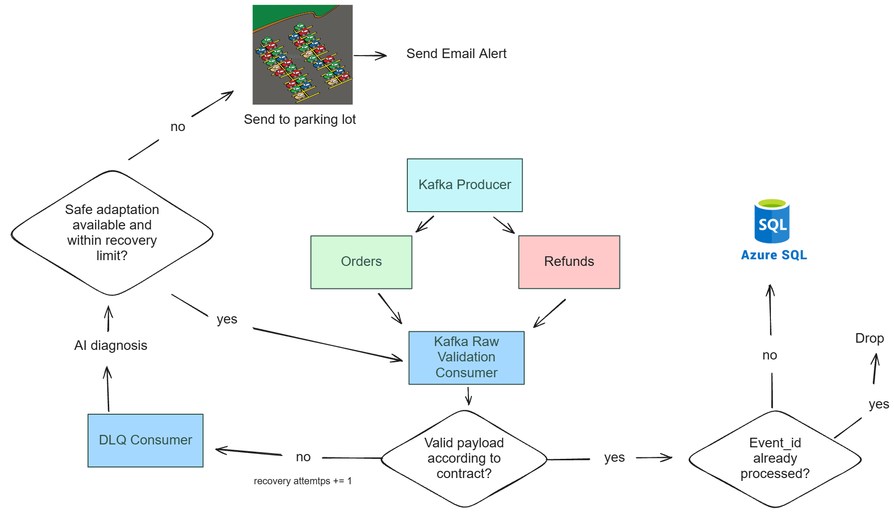

# Curly Store Event-Driven Data Pipeline

In this project, I built an event-driven pipeline using Kafka for a fictional store of products for curly hair.


## How the pipeline works



The pipeline tries to recreate what the Curly Store's flow of data would look like if it were real:

1. **Produce the data:** The data is requested from an API by a KafkaProducer. This fictional API is defined in [event_generator.py](src/producer/event_generator.py). It has an 85% chance of producing an order and a 15% chance of attempting to produce a refund for an already completed order. If no completed order is available or the database connection fails, it produces an order instead. Each event has a 7% chance of schema drift. If drift happens, there's a 70% chance of a potentially repairable type change and a 30% chance of a missing required field, which is sent to the parking lot.

2. **Validate:** The message sent by the producer is consumed and validated using the deterministic review of the `check_schema` function from [SchemaDiagnoser](https://github.com/rojzzzzz/SchemaDiagnoser). The producer adds metadata (`event_id`, `event_type`, and `event_version`); for valid messages that lack an ID or type, the validator adds them. If the payload is valid, it's sent to the processed topic. If it isn't valid, it's sent to the dead-letter queue.

3. **Upload:** After validation, the message is uploaded to the Azure SQL database, where three tables are present: **processed_events**, **orders**, and **refunds**. We check if the *event_id* has already been processed; if it has, we skip it. Otherwise, the event is recorded and uploaded to its corresponding table based on *event_type*. A refund with an invalid amount is sent to the parking lot.

### Recovery Path

When a message is received in the DLQ (for example, because of schema drift), the recovery path starts. It is structured as follows:

1. **AI review:** The `check_schema` function is called once again, with AI review enabled if the recovery attempts threshold hasn't been reached. This review helps us determine if there's a safe adaptation available (removing extra fields, normalizing field names, or safely converting numeric types).

2. **Adapt:** If a safe adaptation is possible and the message hasn't reached the recovery attempts threshold, the adaptation is applied and checked against the contract. Otherwise, the message is sent to the parking lot.

3. **Resent:** Once the adaptation has been applied and passes the check, the message is resent to the raw topic to be validated again before being uploaded. A message that is already valid is also resent.

4. **Alert:** An email alert is attempted for each message sent to the parking lot by the DLQ consumer. Messages sent there by the uploader don't trigger this alert, and email delivery can fail.

## Strategies used

**Producers:** In all KafkaProducers, `enable_idempotence=True` and `acks="all"` are enabled to prevent duplicate messages caused by producer retries and ensure messages are acknowledged by all required in-sync replicas, improving data reliability and durability.

**Consumers:** In all consumers, the `enable_auto_commit` parameter is disabled to have better control over when a message is considered successfully processed. We apply the **AT-LEAST-ONCE** commit strategy in all of them, meaning that we commit offsets only after the message has been successfully processed or routed. This helps manage processing failures and reduces the risk of message loss. The DLQ email alert is attempted after the offset is committed.

**Database:** The at-least-once strategy has a chance of producing duplicates. That's why, to ensure idempotency, we have the **processed_events** table, where every processed *event_id* is stored. If an incoming *event_id* already exists in the table, it means the event is a duplicate, so we skip its processing.

## Cost

For **1 million incoming requests**, assuming 85% orders and drift in 7% of
orders:

| Expected events | Count |
| --- | ---: |
| Orders / refunds | 850,000 / 150,000 |
| Clean orders | 790,500 |
| Drifted orders sent to DLQ | 59,500 |
| Repairable drift (70%) | 41,650 |
| Missing-field drift sent to parking lot (30%) | 17,850 |

At 400–1,000 input tokens per review, the estimated AI cost is **$1.00–$2.50**
($1.75 at 700 tokens). This assumes one uncached review per drifted event, using
[Jev's price](https://docs.typesafe.ai/models) of $0.042 per million input tokens
and free output tokens. Repairable drift does not guarantee a successful repair.

The total also includes Kafka and application hosting, [Azure SQL](https://azure.microsoft.com/en-us/pricing/details/azure-sql-database/single/),
email alerts, networking, and backups. Actual costs depend on deployment and
usage: the [generator](src/producer/event_generator.py) also applies drift to
refunds, and retries or failed repairs can change the number of reviews and alerts.

## How to run

1. Install Docker with Compose. Copy `.env-example` to `.env` and fill in the
   TypeSafe API key, Gmail sender and recipient, SMTP password, and Azure SQL
   credentials. Gmail uses port 465; use an app password if your account requires it.

2. Create an Azure SQL database accessible from Docker. Run the following statement
   in it, then run [TABLES.sql](sql/TABLES.sql):

   ```sql
   CREATE SCHEMA curly_store;
   ```

   The connection requires encryption and a trusted server certificate.

3. Start the pipeline from the project root:

   ```powershell
   docker compose up --build -d
   ```

   Check the services with `docker compose ps` and follow their output with
   `docker compose logs -f`. The producer requests an event every five seconds;
   check the database tables for uploaded events. Stop the pipeline with
   `docker compose down`. Kafka data remains in its Docker volume.

To run the unit tests locally, install Python 3.10 or newer, install the
requirements with `python -m pip install -r requirements.txt`, and run
`python -m unittest discover -s tests`.
